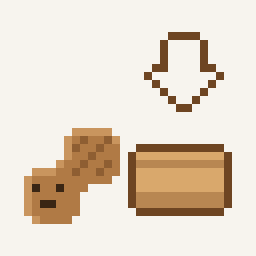

# WaNut

<p align="center">
  <picture>
    <source media="(prefers-color-scheme: dark)" srcset="docs/images/banner-dark.png">
    
  </picture>
</p>

<p align="center">
  <a href="https://github.com/PeanutGT/WaNut/actions/workflows/ci.yml"></a>
  <a href="LICENSE"></a>
  <a href="https://github.com/PeanutGT/WaNut/releases/latest"></a>
  <a href="https://github.com/PeanutGT/WaNut/releases"></a>
  
  
  
</p>

<p align="center"><b>English</b> · <a href="README.zh-TW.md">繁體中文</a></p>

A Windows app for starting your own Minecraft: Java Edition server in a few clicks: no command line, no Java setup, no config files.

> Status: early release (v0.2.5). Works, but expect rough edges.

## Features
**Create**
- Make a Vanilla, Paper, Fabric, Forge or NeoForge server (Minecraft 1.16.5 and newer) from a simple wizard
- Start from a modpack: a Modrinth `.mrpack` or a CurseForge server pack sets up the loader, mods and configs for you
- Import a world, and a Fabric world's mods are installed with it
- Java is downloaded automatically for the Minecraft version you pick
- Run several servers at the same time, each on its own free port

**Run**
- Live console, safe shutdown that never corrupts your world, and a Performance tab with CPU and memory charts
- Player list with faces, plus a menu to kick, ban, OP or whitelist someone
- Game settings, whitelist, OP and ban lists without editing files; "More settings" and an Advanced mode for the rest
- Search and install mods from Modrinth, and turn mods off without deleting them
- When a server crashes, WaNut explains the cause in plain words and offers a fix button

**Keep it safe**
- Automatic world backup before every start and on a schedule while the server runs
- Restore a whole backup or only one dimension, with cleanup rules so backups don't fill your disk

**Play with friends**
- Over LAN or a virtual LAN (Radmin VPN, ZeroTier, Tailscale, Hamachi), with the firewall rule added for you
- Over the internet by opening the router port with UPnP, or through a playit.gg tunnel when that's not possible
- Share an invite card with the address, and post server events to Discord

**Friendly**
- English and Traditional Chinese, light and dark colors, and a pixel peanut that gives you a guided tour
- Download times left, and a notification when long jobs finish
- Updates itself from GitHub Releases

Some of these are on `main` and arrive in the next release.
See [docs/blueprint.md](docs/blueprint.md) for the full design.

## Meet the peanut
A small pixel peanut keeps you company while your server runs.

<p align="center">
  
  
  
  
  
  
</p>

## Installing
Download `WaNut-win-Setup.exe` from the [latest release](https://github.com/PeanutGT/WaNut/releases/latest) and run it. WaNut installs for your Windows account only, so no administrator approval is needed, and it updates itself when a new version comes out. Your servers and worlds live in `%APPDATA%\WaNut` and are kept when WaNut updates or is uninstalled. The installer is not signed yet, so Windows SmartScreen may warn the first time: choose "More info" and then "Run anyway".

## Building
Requires Windows and the .NET 10 SDK.

```
dotnet build
dotnet test
```

## License
WaNut is free software under the [GNU General Public License v3.0](LICENSE). You can use, study, change and share it; if you share a changed version, it must stay open source under the same license.

WaNut is not an official Minecraft product and is not approved by or associated with Mojang or Microsoft. It does not include Minecraft: the server files are downloaded from their official sources on your PC.
